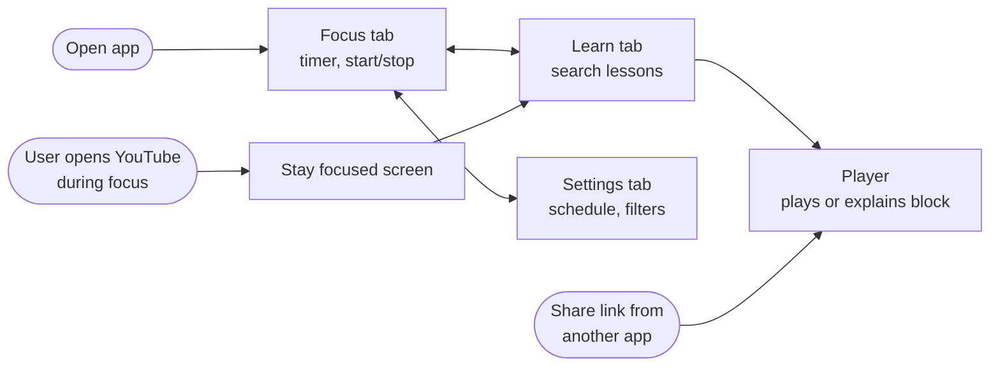
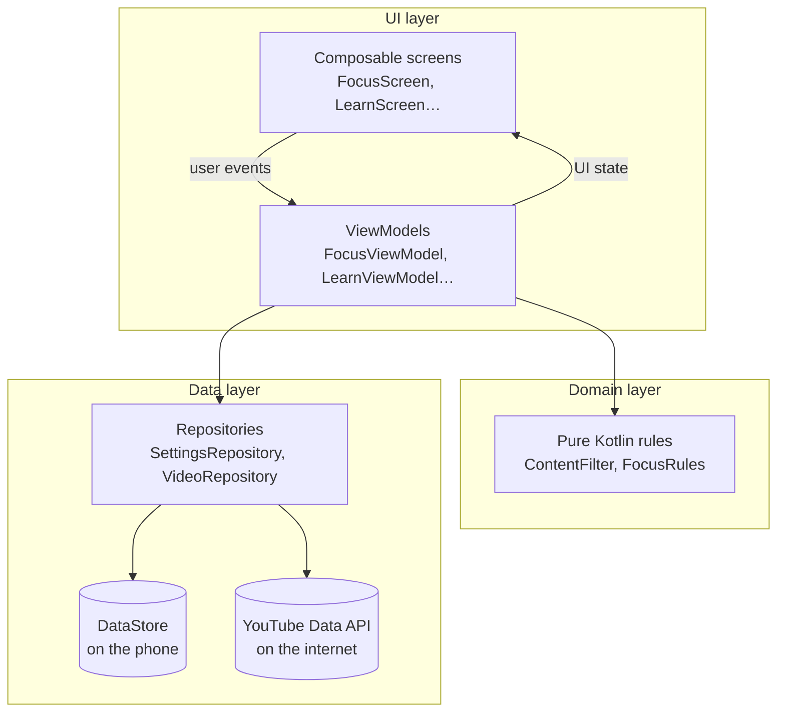

# Learn how to design an Android app (using FocusTube as the example)

This guide follows FocusTube from a one-line idea to working code. Each section
covers one design step, explains the Android concepts it needs, and points to the
files where you can see them used.

**Who it's for:** people who know a little programming (any language) and want to
learn how real Android apps are planned and built. No Android experience needed.

**How to use it:** keep Android Studio open next to this guide. When a file is
mentioned, open it and read along.

---

## Contents

1. [Start with the problem, not the code](#1-start-with-the-problem-not-the-code)
2. [Find out what Android allows](#2-find-out-what-android-allows)
3. [Design the screens](#3-design-the-screens)
4. [The building blocks of an Android app](#4-the-building-blocks-of-an-android-app)
5. [Architecture: organising the code](#5-architecture-organising-the-code)
6. [Building UI with Jetpack Compose](#6-building-ui-with-jetpack-compose)
7. [State and ViewModels](#7-state-and-viewmodels)
8. [Saving data and talking to the internet](#8-saving-data-and-talking-to-the-internet)
9. [Testing](#9-testing)
10. [Exercises: extend FocusTube yourself](#10-exercises-extend-focustube-yourself)
11. [Where to learn more](#11-where-to-learn-more)

---

## 1. Start with the problem, not the code

Before opening Android Studio, write down **who** the app is for, **what problem**
it solves, and **what "done" looks like**. A one-page brief stops you from
building features nobody needs.

**FocusTube's brief**

| Question | Answer |
|---|---|
| Who? | Students and self-learners who use YouTube to study. |
| Problem? | YouTube is full of great lessons, but the recommendations, Shorts and entertainment keep pulling you away. |
| Core idea | For a set time, block entertainment and allow only educational content. |
| Must have | Focus timer; block the YouTube app and site; a way to still watch educational videos. |
| Nice to have | Weekly schedule, strict mode, custom filters. |
| Not doing (yet) | Watch history, accounts, playlists, parental controls. |

> 💡 **Design tip:** the "Not doing" row matters as much as "Must have". Cutting
> scope is how a first version actually gets finished.

### Turn the brief into user stories
User stories describe features from the user's point of view. Each one should
become something you can test.

- *As a student, I want to start a 50-minute focus session so that I stop opening YouTube.*
- *As a student, I want to search for "calculus" and only see lessons.*
- *As a student, I want a friend's shared link to work if it's a real lesson.*
- *As someone with weak willpower, I want to be unable to cancel a session early.*

---

## 2. Find out what Android allows

This is the step beginners skip most often. **Your design has to fit what the
platform actually lets an app do.**

FocusTube's main question was: *how can one app control what another app (YouTube) shows?*

| Option | What it can do | Why we did or didn't use it |
|---|---|---|
| Modify the YouTube app | Nothing. Android apps are isolated from each other (sandboxing). | ❌ Not possible. |
| **Accessibility service** | Sees which app is on screen and can read text on screen, such as a browser's address bar. Can send the user Home. | ✅ **Used to block YouTube** during focus. Needs clear user consent. |
| Usage stats (`UsageStatsManager`) | Reports which app was in the foreground, with some delay. | ⚠️ Slower to react, and can't see browser URLs. |
| Local VPN / DNS filter | Blocks domains for the whole phone. | ⚠️ Can't tell a lecture from a prank: it's all `youtube.com`. |
| **YouTube Data API + embedded player** | Search YouTube, read each video's *category*, and play videos in our own app. | ✅ **Used to show only educational videos.** |

**The design decision:** since we can't filter *inside* the YouTube app, we
**block it** during focus and **give the user a better place to learn**, which is
FocusTube's own filtered search and player.

> 💡 **Design tip:** write down decisions like this, including the options you
> rejected and why. Developers call this an *Architecture Decision Record*. Six
> months from now you'll be glad you did.

### Permissions and trust
Powerful features need the user's permission, and app stores check how you use
them. Two lessons from FocusTube:

- **Explain before you ask.** `FocusScreen.kt` → `BlockerSetupCard` shows a dialog
  explaining exactly what the accessibility service does *before* opening the
  system settings. Google Play requires this ("prominent disclosure"), and it's
  also simply good design.
- **Ask for as little as possible.** `BlockerAccessibilityService.onServiceConnected()`
  limits the service to YouTube apps and browsers, so it never sees your banking
  app or messages.

---

## 3. Design the screens

### Map the user flow first
Sketch how the user moves between screens before you draw any single screen.



### Wireframes: boxes before beauty
Draw low-detail sketches on paper or in a tool like Figma. Focus on **what's on
the screen and why**, not on colours.

```
┌─────────────────────────┐   ┌─────────────────────────┐   ┌─────────────────────────┐
│ FocusTube               │   │ [🔍 What to learn?    ] │   │ ←  Now learning         │
│ ┌─────────────────────┐ │   │                         │   │ ┌─────────────────────┐ │
│ │ Focus mode is on    │ │   │ 3 results hidden        │   │ │                     │ │
│ │     42:17           │ │   │ ┌─────────────────────┐ │   │ │     ▶  video        │ │
│ │ ends at 3:45 PM     │ │   │ │   thumbnail   12:30 │ │   │ │                     │ │
│ └─────────────────────┘ │   │ │ Intro to calculus   │ │   │ └─────────────────────┘ │
│ (25m)(50m)(1h)(2h)(4h)  │   │ │ Channel name        │ │   │ Intro to calculus       │
│ [  Focus for 50 min   ] │   │ └─────────────────────┘ │   │ Channel name            │
│ Strict mode      [ ●] │   │ ┌─────────────────────┐ │   │ Description…            │
│                         │   │ │   ...               │ │   │                         │
├─────────────────────────┤   ├─────────────────────────┤   ├─────────────────────────┤
│  Focus   Learn  Settings│   │  Focus   Learn  Settings│   │  Focus   Learn  Settings│
└─────────────────────────┘   └─────────────────────────┘   └─────────────────────────┘
```

### Follow Material Design 3
Android's design system, [Material 3](https://m3.material.io), gives you tested
patterns so you don't have to invent them:

- **Navigation bar** at the bottom for 3–5 top-level destinations (`FocusTubeAppUi.kt`).
- **Cards** group related information (the status card and video cards).
- **Chips** for picking from a few options (session lengths, days of the week).
- **Switches** for on/off settings, and **dialogs** for important decisions.
- **Dynamic colour**: on Android 12+ the app takes its colours from the user's
  wallpaper (`ui/theme/Theme.kt`).

### UX principles in FocusTube

| Principle | Where you'll see it |
|---|---|
| Show the system's status | A large countdown and "ends at 3:45 PM" on the Focus tab. |
| Explain, don't just refuse | Blocked videos show *why*, for example "'Comedy' is not an allowed category". |
| Make the right thing easy | The blocked screen has a big **Learn in FocusTube** button. |
| Make the wrong thing harder | Strict mode disables "End session" and greys out filter settings. |
| Be honest about filtering | Search shows "3 non-educational results hidden". |
| Calm visuals | Teal instead of YouTube red. A focus app shouldn't shout. |

---

## 4. The building blocks of an Android app

Every Android app is put together from a few standard parts:

| Building block | What it is | In FocusTube |
|---|---|---|
| **Manifest** | The app's ID card. It tells Android what the app contains and what it needs. | `AndroidManifest.xml` |
| **Activity** | A window the user interacts with. | `MainActivity` (all main screens), `BlockedActivity` |
| **Service** | Code that runs without its own screen. | `BlockerAccessibilityService` |
| **Intent** | A message that says "do this", such as opening a screen or sharing text. | Share-to-FocusTube, opening Accessibility settings |
| **Application** | One object that lives as long as the app process. | `FocusTubeApp` |
| **Resources** | Text, colours, icons and layouts kept outside the code. | `res/values/strings.xml`, `res/drawable/` |

### The manifest, line by line
Open `app/src/main/AndroidManifest.xml`:

- `<uses-permission android:name="android.permission.INTERNET"/>` is needed to talk to YouTube.
- The `MainActivity` intent filters say:
  - `MAIN` + `LAUNCHER`: show this app in the app drawer.
  - `SEND` + `text/plain`: list FocusTube in the **Share** menu for text, which includes links.
  - `VIEW` + `https://youtube.com/...`: offer FocusTube when the user taps a YouTube link.
- The `<service>` is protected by `BIND_ACCESSIBILITY_SERVICE`, so only the system can connect to it.

### Why put all text in `strings.xml`?
You'll see `stringResource(R.string.focus_on)` instead of `"Focus mode is on"`.
Keeping text in resources means the app can be **translated** by adding
`res/values-es/strings.xml`, `res/values-ar/strings.xml` and so on, without
changing any code.

### Single-activity apps
Modern apps usually have **one activity**. Screens are *destinations* that a
navigation library switches between (`FocusTubeAppUi.kt` uses Navigation Compose).
`BlockedActivity` is separate on purpose: the accessibility service needs to show
it on top of *other* apps.

---

## 5. Architecture: organising the code

Small apps work with everything in one file, but they become impossible to change
later. Google's recommended
[app architecture](https://developer.android.com/topic/architecture) splits code
into **layers**, and each layer has one job:



| Layer | Job | Knows about Android? |
|---|---|---|
| **UI** (screens) | Draws state and reports clicks. No decisions. | Yes |
| **ViewModel** | Holds screen state and turns user events into actions. | A little |
| **Domain** | The app's rules: "is this educational?", "is focus on?" | **No.** Plain Kotlin, easy to test |
| **Data** (repositories) | Gets and saves data, and hides *where* it comes from. | Yes |

### Unidirectional data flow (UDF)
This is the most important idea in modern Android UI:

> **State flows down, events flow up.**

1. `SettingsRepository` emits a new `FocusSettings`.
2. `FocusViewModel` turns it into a `FocusUiState`.
3. `FocusScreen` draws that state.
4. The user taps **Focus for 50 min**, and the screen calls `viewModel.startSession(50)`.
5. The ViewModel tells the repository, which saves the change and emits new settings. The cycle starts again at step 1.

The screen **never** changes data directly. Since there's only one path, bugs are
easier to find.

### Where do rules belong?
Look at **strict mode**. The *UI* disables the "End session" button, but the
*real* check is in `SettingsRepository.editUnlessLocked()`. If a future screen
forgets to disable a button, the rule still holds.

> 💡 **Design tip:** the UI is for *convenience*; the data and domain layers are
> for *correctness*.

### Dependency injection, the simple version
`AppContainer` in `FocusTubeApp.kt` creates the repositories **once** and hands
them to whoever needs them. ViewModels receive repositories in their constructor
instead of creating them. That makes them easy to test with fake repositories.
Larger apps use a library called **Hilt** for this, but the idea is exactly the same.

---

## 6. Building UI with Jetpack Compose

[Jetpack Compose](https://developer.android.com/compose) is Android's modern UI
toolkit. You describe the UI as **functions of state**:

```kotlin
@Composable
fun Greeting(name: String) {
    Text("Hello, $name!")
}
```

When `name` changes, Compose **recomposes**: it calls the function again and
updates only what changed.

### Key concepts, with real examples

**Layout: `Column`, `Row`, `Box`.** `VideoCard.kt` uses a `Box` to place the
duration badge on top of the thumbnail (`Modifier.align(Alignment.BottomEnd)`).

**Modifiers** change size, padding, click behaviour and more. Order matters:

```kotlin
Modifier
    .padding(8.dp)                                       // space outside the badge
    .background(Color.Black, RoundedCornerShape(4.dp))   // the badge background
    .padding(horizontal = 6.dp)                          // space inside the badge
```

**Local state with `remember`.** In `FocusScreen.kt`:

```kotlin
var selectedMinutes by rememberSaveable { mutableIntStateOf(50) }
```

`remember` keeps a value between recompositions. `rememberSaveable` also keeps it
when the phone rotates.

**State hoisting.** Most composables don't own their state. They receive it as
parameters and report changes through callbacks. Compare:

- `FocusScreen(viewModel)` is the *stateful* wrapper that collects from the ViewModel.
- `FocusContent(state, onStart, onEnd, …)` is *stateless* and easy to preview or test.

This is the same "state down, events up" idea from §5, applied to a single screen.

**Lists: `LazyColumn`.** `LearnScreen.kt` shows search results in a `LazyColumn`,
which only creates the rows currently on screen. `key = { it.id }` helps Compose
keep each row's state attached to the right video.

**Side effects.** Some code must run *because* of composition, not *during* it:

- `LaunchedEffect(pendingVideoId)` in `FocusTubeAppUi.kt` navigates to the player when a link is shared.
- `LifecycleResumeEffect` in `FocusScreen.kt` re-checks whether the blocker is on each time the user returns from system settings.
- `DisposableEffect` in `PlayerScreen.kt` releases the video player when you leave the screen.

**Using classic Android Views.** The YouTube player is a classic `View`, not a
composable. `AndroidView(factory = { playerView })` embeds it in Compose.

---

## 7. State and ViewModels

### Why ViewModels?
When you rotate the phone, Android **destroys and recreates** the activity. Any
variable inside it is lost. A **ViewModel** survives that, so your search results
don't vanish when the phone turns.

### Streams of data with `Flow`
`SettingsRepository.settings` is a `Flow<FocusSettings>`: a stream that emits a
new value every time settings change. The ViewModel combines streams:

```kotlin
// FocusViewModel.kt
val uiState = combine(settingsRepository.settings, clockTicks()) { settings, now ->
    FocusUiState(now, settings, settings.focusStatus(now), …)
}.stateIn(viewModelScope, SharingStarted.WhileSubscribed(5_000), initialValue = null)
```

- `combine` updates the UI when settings change **or** every second for the countdown.
- `stateIn` turns it into a `StateFlow`, which always has a current value.
- `WhileSubscribed(5_000)` stops the work 5 seconds after the screen goes away,
  which saves battery. The 5-second delay means a quick rotation doesn't restart it.

The screen reads it like this:

```kotlin
val state by viewModel.uiState.collectAsStateWithLifecycle()
```

### Modelling UI state
`PlayerUiState` uses a **sealed interface**, so the screen can be in exactly one
state at a time:

```kotlin
sealed interface PlayerUiState {
    data object Loading : PlayerUiState
    data class Error(val message: String) : PlayerUiState
    data class Ready(val video: VideoInfo, val decision: FilterDecision, …) : PlayerUiState
}
```

The `when (state)` in `PlayerScreen` must handle every case, and the compiler
checks that you didn't forget one.

### Coroutines: doing slow work without freezing the app
Network calls and disk access are slow. `viewModelScope.launch { … }` runs them in
a **coroutine**, a lightweight background task, so the UI stays smooth. When the
ViewModel is cleared, its coroutines are cancelled automatically.

---

## 8. Saving data and talking to the internet

### Saving settings: DataStore
`SettingsRepository` uses
[Preferences DataStore](https://developer.android.com/topic/libraries/architecture/datastore)
to store small key–value settings, such as the session end time and blocked words.

- Reads come as a `Flow`, so the UI updates automatically when data changes.
- Writes use `dataStore.edit { prefs -> … }`, which is safe even when two writes happen at once.
- A missing key means "never set, use the default". An **empty** set is a real choice the user made.

For larger, structured data such as watch history, you'd use the **Room** database instead.

### Talking to the YouTube API: Retrofit
`YouTubeApi.kt` describes the web API as a Kotlin interface:

```kotlin
@GET("search")
suspend fun search(@Query("q") query: String, @Query("key") apiKey: String, …): SearchResponse
```

Retrofit generates the code that makes the HTTP request, and
**kotlinx.serialization** turns the JSON response into the `@Serializable` data
classes below it.

The **repository pattern** in practice: `VideoRepository` hides two API calls
(search returns only IDs, then `videos` returns the details) behind one simple
`search(query)` function. The ViewModel doesn't know or care how many requests
that took.

### Handling errors
Networks fail. `VideoRepository.describe(error)` turns technical exceptions into
messages a person can act on, such as *"Couldn't reach YouTube. Check your
internet connection."* instead of `java.net.UnknownHostException`.

### Secrets: API keys
Never commit API keys to git. FocusTube reads the key from `local.properties`
(which `.gitignore` excludes) and puts it into `BuildConfig` at build time
(`app/build.gradle.kts`).

---

## 9. Testing

The `domain/` package is **pure Kotlin with no Android imports**. That design
choice means it can be tested in milliseconds on your computer:

```bash
./gradlew test
```

Open `app/src/test/.../ContentFilterTest.kt` and look at how a test reads like a
specification:

```kotlin
@Test
fun `blocked keywords match whole words only, ignoring case`() {
    assertFalse(filter.isAllowed(video(title = "Physics PRANK gone wrong")))
    assertTrue(filter.isAllowed(video(title = "Memento mori in Stoic philosophy")))
}
```

Tricky logic deserves tests: schedules that cross midnight, overlapping sessions,
and the many shapes of YouTube links are all covered.

| Test type | Runs on | Good for |
|---|---|---|
| Unit tests (`src/test`) | Your computer | Rules and logic (FocusTube has these) |
| Instrumented tests (`src/androidTest`) | Phone or emulator | Databases and Android APIs |
| Compose UI tests | Phone or emulator | "Tap this, expect that" on screens |

---

## 10. Exercises: extend FocusTube yourself

The best way to learn is to change working code. These go roughly from easy to hard:

1. **Add a 15-minute session option.** *Hint:* `SESSION_LENGTHS_MINUTES` in `FocusScreen.kt`.
2. **Translate the app.** Create `res/values-<language code>/strings.xml`.
3. **Add a Compose `@Preview`** for `VideoCard` so you can see it without running the app.
4. **Add a blocked keyword test.** Write a failing test in `ContentFilterTest` first, then make it pass.
5. **Notify when focus ends.** Use `AlarmManager` or WorkManager plus `NotificationManager`.
   You'll learn about notification channels and the `POST_NOTIFICATIONS` permission.
6. **Track focus history.** Store finished sessions in a Room database and show a weekly chart.
7. **Daily YouTube allowance.** Allow 20 minutes of normal YouTube per day, and block it after that.
   *Hint:* measure time in `BlockerAccessibilityService`.
8. **Home screen widget** showing the countdown, using Jetpack Glance.
9. **Better classification.** Also allow videos whose title matches subjects the
   user chooses, such as "physics" or "algebra", or send the title to an AI model
   to rate how educational it is.

---

## 11. Where to learn more

**Official free courses (in this order):**
1. [Android Basics with Compose](https://developer.android.com/courses/android-basics-compose/course): Kotlin and Compose from zero.
2. [Jetpack Compose pathway](https://developer.android.com/courses/jetpack-compose/course): deeper into Compose.
3. [Guide to app architecture](https://developer.android.com/topic/architecture): the layers from §5 in detail.

**Design:**
- [Material 3 guidelines](https://m3.material.io): components, colour, typography.
- [Android design for developers](https://developer.android.com/design): layouts for phones, tablets and foldables.

**Real-world code to study:**
- [Now in Android](https://github.com/android/nowinandroid): Google's full sample app, which follows every best practice.
- [Compose samples](https://github.com/android/compose-samples): smaller, focused examples.

**Specific to this app:**
- [AccessibilityService guide](https://developer.android.com/guide/topics/ui/accessibility/service)
- [Google Play Accessibility API policy](https://support.google.com/googleplay/android-developer/answer/10964491)
- [YouTube Data API reference](https://developers.google.com/youtube/v3/docs)

---

### Checklist for designing your *next* app

- [ ] One-page brief: who, problem, must-haves, *not doing*
- [ ] Researched what Android allows for the hard parts
- [ ] Wrote down key decisions and the options rejected
- [ ] User-flow diagram, then wireframes
- [ ] Picked Material components for each screen
- [ ] Planned layers: UI → ViewModel → (domain) → repository → data source
- [ ] Kept business rules in plain Kotlin and tested them
- [ ] Asked only for permissions you need, and explained why first
- [ ] Kept secrets out of git
